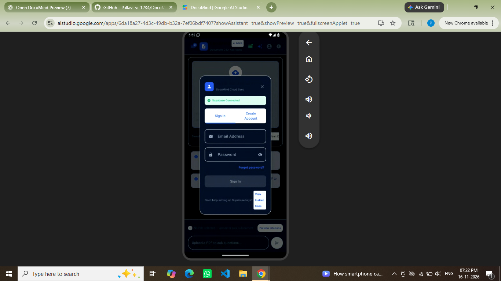
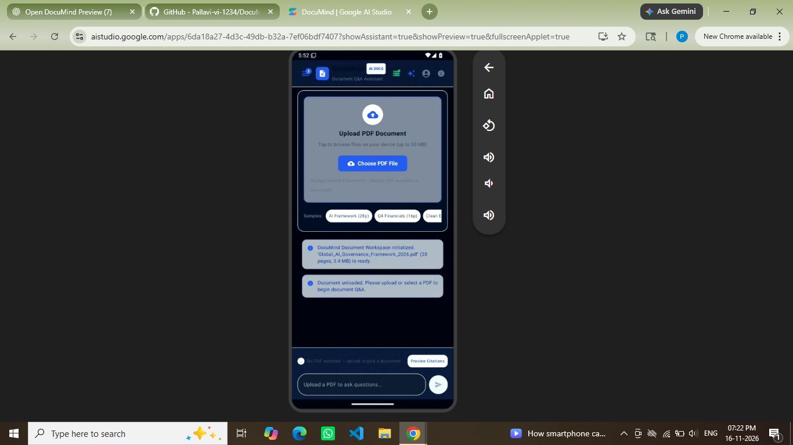
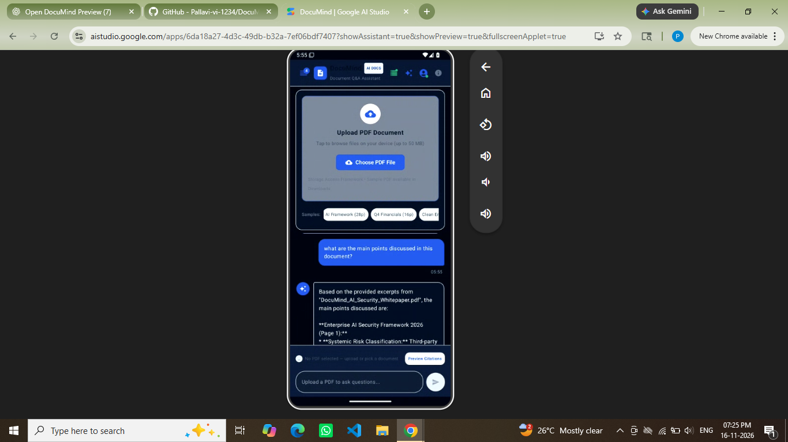

# DocuMind

DocuMind is an Android **Retrieval-Augmented Generation (RAG)** document assistant built with **Kotlin**, **Jetpack Compose (Material 3)**, **Google Gemini**, and **Supabase** (`pgvector`, Authentication, Storage, and Row-Level Security). Upload PDF documents, extract and index their contents into 768-dimensional vector embeddings, and ask questions with strictly grounded answers and clickable page-number citations.

---

## Features

- **Real PDF Text Extraction & Scanned-PDF Detection**
  - Uses Android's Storage Access Framework (`ActivityResultContracts.OpenDocument`) and `PdfBox-Android` to extract text page by page from multi-page PDFs.
  - Detects image-only/scanned PDFs without an embedded text layer and notifies the user cleanly instead of indexing empty content.
- **Semantic Chunking with Page & Section Preservation**
  - Splits extracted pages into overlapping chunks (`TextChunker`: 650-character target with 120-character overlap) while preserving exact page numbers and inferred section titles.
- **768-Dimensional Vector Embeddings (`pgvector`)**
  - Generates L2-normalized 768-dimensional embeddings via Google Gemini `models/gemini-embedding-001` (`RETRIEVAL_DOCUMENT` for indexing, `RETRIEVAL_QUERY` for user questions).
  - Stores document metadata, chunk text, and `vector(768)` embeddings in Supabase PostgreSQL and queries relevant excerpts via the `match_document_chunks` RPC function.
  - Supports one-tap **Re-indexing (`Index Chunks`)** for PDFs already stored in the user's private Supabase Storage bucket.
- **Grounded Document Q&A with Inline Page Citations**
  - Sends retrieved document chunks to Gemini (`gemini-3.5-flash`) with strict grounding instructions so answers are derived only from the selected PDF.
  - Renders clickable page citations and a **Citation Inspector** dialog showing similarity score, section title, page number, and matched source excerpt.
  - Persists chat sessions and messages in Supabase (`chat_sessions`, `chat_messages`), with dedicated loading, empty-result, and error states.
- **Supabase Authentication & Private Storage**
  - Email/password Sign Up, Sign In, Sign Out, and Forgot Password flows via Supabase Auth (GoTrue REST API).
  - Uploads PDFs to a private Supabase Storage bucket (`documents`) scoped by `<user_id>/<document_id>.pdf` and enforced by PostgreSQL Row-Level Security (`supabase_schema.sql`).
- **Browser & Deep-Link Password Recovery**
  - Supports browser-compatible HTTPS password reset (`web/reset-password.html` and optional Edge Function `supabase/functions/reset-password/index.ts`) alongside Android App Links and `documind://reset-password` custom-scheme fallbacks.
- **Adaptive Material 3 Interface**
  - Edge-to-Edge Compose layout with a persistent sidebar on wide/tablet displays and a modal navigation drawer on compact mobile screens.

---

## Architecture

DocuMind follows a clean **MVVM (Model-View-ViewModel)** architecture with unidirectional state flow (`StateFlow<DocuMindUiState>`) and decoupled data/utility services:

```text
DocuMind
├── app/src/main/java/com/example/
│   ├── MainActivity.kt                        # Edge-to-edge host, cold/warm deep-link forwarding
│   ├── model/
│   │   └── DocumentModel.kt                   # UI models (DocumentItem, ChatMessage, Citation, UI state)
│   ├── util/
│   │   ├── PdfTextExtractor.kt                # Page-by-page PDFBox extraction + scanned PDF check
│   │   └── TextChunker.kt                     # Overlapping chunker preserving page numbers & sections
│   ├── data/
│   │   ├── DocumentHelper.kt                  # Sample PDF seeding & SAF helpers
│   │   ├── SampleDocuments.kt                 # Local preview definitions
│   │   ├── gemini/
│   │   │   ├── GeminiEmbeddingService.kt      # gemini-embedding-001 (768-dim, L2-normalized)
│   │   │   └── GeminiQaService.kt             # gemini-3.5-flash grounded Q&A prompt & parser
│   │   └── supabase/
│   │       ├── SupabaseConfig.kt              # BuildConfig / .env / env var resolution
│   │       ├── SupabaseAuthManager.kt         # Auth sessions, token refresh, password recovery
│   │       ├── SupabaseApiClient.kt           # PostgREST, private Storage, match_document_chunks RPC
│   │       ├── AuthDeepLinkParser.kt          # HTTPS & documind:// recovery URI token parser
│   │       └── model/SupabaseModels.kt        # Moshi DTOs for Supabase REST & RPC payloads
│   ├── viewmodel/
│   │   └── DocuMindViewModel.kt               # Orchestrates auth, PDF upload, indexing, RAG & chat
│   └── ui/
│       ├── DocuMindApp.kt                     # Adaptive scaffold, drawer, modals & recovery routing
│       ├── theme/                             # Material 3 Color, Theme & Typography
│       └── components/                        # TopBar, SidebarDrawer, UploadArea, ChatSection,
│                                              # CitationInspectorSheet, AuthDialog, PasswordRecoveryScreen,
│                                              # GeminiKeyDialog, SupabaseConfigDialog, DocumentDetailsDialog
├── supabase/
│   ├── config.toml                            # Edge Function configuration
│   └── functions/reset-password/index.ts      # Supabase Edge Function password recovery callback
├── web/
│   ├── reset-password.html                    # Static browser password reset callback page
│   └── index.html                             # Downloadable copy for static hosting (e.g., Netlify)
├── supabase_schema.sql                        # PostgreSQL schema, pgvector, match_document_chunks RPC, RLS
└── .env.example                               # Template for BuildConfig secrets via Secrets Gradle Plugin
```

---

## Tech Stack

| Layer | Technology |
| --- | --- |
| **Language** | Kotlin `2.2.10` |
| **UI Framework** | Jetpack Compose (`Compose BOM 2024.09.00`), Material 3, Edge-to-Edge |
| **Async / Concurrency** | Kotlin Coroutines `1.10.2`, `StateFlow` |
| **PDF Processing** | `com.tom-roush:pdfbox-android:2.0.27.0` |
| **Networking & JSON** | OkHttp `4.10.0`, Retrofit `2.12.0`, Moshi `1.15.2` (with KSP codegen) |
| **AI & Embeddings** | Google Gemini REST API (`models/gemini-embedding-001`, `gemini-3.5-flash`) |
| **Backend & Vector DB** | Supabase Auth, Private Storage, PostgreSQL + `pgvector` (`vector(768)`) |
| **Build & Secrets** | AGP `9.1.1`, Gradle Kotlin DSL, Secrets Gradle Plugin `2.0.1` |
| **Testing** | JUnit `4.13.2`, Robolectric `4.16.1`, Compose UI Test, Coroutines Test |

---

## Setup Instructions

### 1. Prerequisites

- **Android Studio** (or Gradle CLI with JDK 11+) and Android SDK (`compileSdk 36`, `minSdk 24`).
- A **Google AI Studio** Gemini API key ([aistudio.google.com/app/apikey](https://aistudio.google.com/app/apikey)).
- A **Supabase** project ([supabase.com/dashboard](https://supabase.com/dashboard)).

### 2. Configure Environment Variables

The Secrets Gradle Plugin reads environment keys from `.env` at the project root (falling back to `.env.example` if `.env` is not present) and exposes them via `BuildConfig`:

1. Copy `.env.example` to `.env`:
   ```bash
   cp .env.example .env
   ```
2. Edit `.env` with your own credentials (never commit `.env`):
   ```dotenv
   GEMINI_API_KEY=your_gemini_api_key_here
   SUPABASE_URL=https://your-project-id.supabase.co
   SUPABASE_ANON_KEY=your_supabase_publishable_or_anon_key
   ```
   > **Note (AI Studio / CI):** You can also supply `GEMINI_API_KEY` via the AI Studio Secrets panel or enter it directly inside the app's **Gemini API Key** dialog (stored in app-private `SharedPreferences`). Do not place API keys in `local.properties`.

### 3. Initialize the Supabase Backend

1. Open your project in the **Supabase Dashboard** → **SQL Editor**.
2. Paste and execute the entire contents of [`supabase_schema.sql`](./supabase_schema.sql). This creates:
   - `pgvector` extension
   - `profiles`, `documents`, `document_chunks` (`vector(768)`), `chat_sessions`, and `chat_messages` tables
   - `match_document_chunks` cosine-similarity RPC enforcing `auth.uid()` ownership
   - Private `documents` Storage bucket and Row-Level Security (RLS) policies
3. In **Authentication → URL Configuration**, add your password recovery redirect URL(s):
   - Your hosted HTTPS callback URL (e.g. `https://your-reset-site.netlify.app`), and/or
   - `documind://reset-password` (for direct Android deep-link fallback).

### 4. Optional: Password Recovery Web Callback

To host your own browser-compatible password recovery callback:
- **Static hosting (Netlify, Vercel, etc.):** Update `SUPABASE_URL` and `SUPABASE_ANON_KEY` in `web/reset-password.html` (and `DEFAULT_WEB_RESET_REDIRECT_URL` / `AndroidManifest.xml` host) to match your own Supabase project and deployed domain.
- **Supabase Edge Function:** Deploy `supabase/functions/reset-password/index.ts` (uses `SUPABASE_URL` and `SUPABASE_ANON_KEY` from Edge Function secrets). Never expose a `service_role` key in client or browser code.

### 5. Build & Run Tests

- **Build debug APK:**
  ```bash
  gradle assembleDebug
  ```
- **Run unit & Robolectric tests:**
  ```bash
  gradle :app:testDebugUnitTest
  ```

---

## Security & Credentials Policy

- `.env`, `.env.*`, `local.properties`, keystores (`*.keystore`, `*.jks`, `debug.keystore.base64`), build outputs (`.build-outputs/`, `*.apk`, `*.aab`), and `google-services.json` are excluded via `.gitignore`.
- **Never commit** `GEMINI_API_KEY`, Supabase `service_role` / `sb_secret_*` keys, signing passwords, or personal user credentials.
- All database and storage operations in the client use the RLS-protected publishable/anon key paired with an authenticated user JWT; unauthorized inserts/reads are blocked at the PostgreSQL policy layer.
- Note: `.env.example` and `web/reset-password.html` include a non-privileged, RLS-protected Supabase project URL and publishable client key for reference/preview builds—replace them with your own Supabase project values when forking or self-hosting.

---

## Screenshots

> Add captured emulator/device screenshots under `docs/screenshots/` to populate the preview gallery below.

| Sign In & Auth | Document Upload & Library | Grounded Q&A & Citations | Citation Inspector |
| :---: | :---: | :---: | :---: |
|  |  |  |  |
